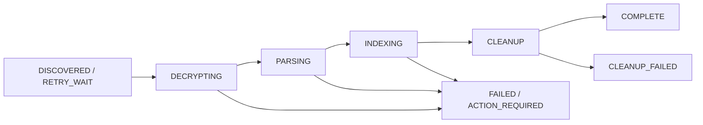

# 엔진 연동 명세

기준은 `app/api/apps/restful_apis/docmind_api.py`, `docmind_ingestion_service.py`, `docmind_worker_auth.py`다. 아래 ID·해시·시간은 예시이며 그대로 송신하는 테스트 데이터가 아니다. 암호화 원본 연결은 기존 Windows 워커를 사용하는 것이 기본이다.

## 1. 인증과 응답 검증

접두사는 `/api/v1`. HMAC 키는 32바이트이며, API는 원시 바이트 또는 64자리 hex/base64 파일을 읽는다. 같은 키를 Windows 워커에 공급한다. 타임스탬프는 Unix 초, 허용 시계 차이는 300초다.

```text
X-DocMind-Key-Id: <등록된-key-id>
X-DocMind-Timestamp: <Unix 초>
X-DocMind-Nonce: <요청마다 새로운 nonce>
X-DocMind-Content-SHA256: <실제로 전송한 본문 바이트의 소문자 SHA256>
X-DocMind-Signature: <HMAC-SHA256 소문자 hex>
```

서명 원문은 아래 다섯 필드를 LF로 연결한다. 마지막에 줄바꿈을 덧붙이지 않는다. 메서드는 대문자, 경로에는 `/api/v1`과 실제 쿼리를 포함한다. JSON을 서명한 뒤 다시 직렬화하면 해시가 달라질 수 있다.

```text
METHOD\nPATH_AND_QUERY\nTIMESTAMP\nNONCE\nCONTENT_SHA256
```

응답에도 같은 이름의 서명 헤더가 온다. 받은 원문 바이트의 해시·서명·시간·응답 nonce를 검증한 뒤 JSON을 사용한다. 검증 없이 `accepted: true`만 믿지 않는다. 인증 실패 401 응답은 서명되지 않을 수 있으므로 실패로만 처리한다. 정상 ACK의 job/version/fence도 원래 임대와 대조한다. 자세한 응답 canonical 처리는 기존 [공통 라이브러리](../../tools/windows/DocMindUEncryptorHostWorker.Common.ps1)를 기준으로 한다.

## 2. 원본 버전 관찰

`POST /api/v1/cloud-sync/host-worker/observations`

```json
{"source_id":"handoff-sample","document_id":"11111111111111111111111111111111","relative_path":"sample.docx","ciphertext_sha256":"aaaaaaaaaaaaaaaaaaaaaaaaaaaaaaaaaaaaaaaaaaaaaaaaaaaaaaaaaaaaaaaa","size":4096,"mtime_ns":1794272400000000000}
```

정확히 위 필드가 필요하고 `size`, `mtime_ns`는 정수다. 이 API는 이미 등록된 문서의 버전 관찰용이다. 처음 발견한 파일의 문서 생성은 감시기의 세션·변경·스캔 프로토콜을 사용한다. 새 개발자가 observations로 신규 문서를 임의 생성하면 안 된다.

안정 관찰 전 응답 예: `{"state":"WAITING_SOURCE_STABLE","stable_observations":1}`. 등록 가능한 상태에서는 `{"state":"DISCOVERED","version_id":"…","job_id":"…"}`. 이전 작업 정리가 남으면 `DEFERRED_PREVIOUS_CLEANUP`일 수 있다. 전송 성공과 작업 생성은 구분한다.

## 3. 작업 임대와 유효성 확인

`POST /api/v1/cloud-sync/host-worker/claim`

```json
{"worker_id":"handoff-worker","protocol_version":1,"lease_seconds":1800,"claim_source_id":"handoff-sample"}
```

응답 예:

```json
{"job":{"job_id":"22222222222222222222222222222222","source_id":"handoff-sample","document_id":"11111111111111111111111111111111","version_id":"33333333333333333333333333333333","relative_path":"sample.docx","ciphertext_sha256":"aaaaaaaaaaaaaaaaaaaaaaaaaaaaaaaaaaaaaaaaaaaaaaaaaaaaaaaaaaaaaaaa","fencing_token":1,"lease_expires_at":"2026-11-10T03:30:00Z"}}
```

작업이 없으면 `{"job":null}`이며 실패가 아니다. `lease_seconds`는 30~1,800초. 풀의 `ingestion_pool_size`는 1~12이며 실제 서버 슬롯 상한과 함께 작동한다. `claim_job_id`는 기존 특정 시험용 제약이 있으므로 범용 작업 지정 API로 사용하지 않는다.

`POST /api/v1/cloud-sync/host-worker/jobs/{job_id}/validate`

```json
{"worker_id":"handoff-worker","version_id":"33333333333333333333333333333333","fencing_token":1}
```

정상: `{"valid":true,"lease_expires_at":"2026-11-10T03:30:00Z"}`. 이 요청은 임대를 갱신하는 기능이 아니다.

## 4. 평문 전달

`PUT /api/v1/cloud-sync/host-worker/jobs/{job_id}/artifact`

본문은 JSON이나 multipart가 아니라 **복호화한 파일의 원시 바이트**다. 기본 HMAC 헤더에 아래를 추가한다.

```text
Content-Type: application/octet-stream
Content-Length: <정확한 바이트 수>
X-DocMind-Worker-Id: <claim한 worker_id>
X-DocMind-Version-Id: <version_id>
X-DocMind-Fencing-Token: <정수 fence>
X-DocMind-Plaintext-SHA256: <평문 SHA256>
X-DocMind-Plaintext-Size: <정확한 바이트 수>
```

Content-Length는 필수(없으면 411). API 기본 최대 256MiB이며 파서의 별도 입력 크기·형식 제한도 적용된다. 256MiB가 모든 문서의 처리 보장 크기는 아니다. 요청은 파싱·색인·서버 정리까지 기다릴 수 있다. CLI 복호화 timeout과 별개로 남은 lease 안에서 기다린다.

성공 ACK: `{"accepted":true,"job_id":"…","version_id":"…","fencing_token":1}`. 이때에도 호스트 파일을 지우고 정리 상태를 보고해야 전체 완료다. 네트워크가 끊겼다고 같은 artifact를 무조건 재전송하지 않는다. 이미 활성화됐거나 임대가 바뀌었을 수 있다.

## 5. 호스트 정리·ACK

`POST /api/v1/cloud-sync/host-worker/jobs/{job_id}/status`

```json
{"worker_id":"handoff-worker","version_id":"33333333333333333333333333333333","fencing_token":1,"status":"CLEANED","error_code":null}
```

정상 ACK: `{"accepted":true,"job_id":"…","version_id":"…","fencing_token":1,"cleanup_required":false}`. `CLEANED`는 호스트 파일이 실제로 사라진 뒤 보낸다. 기존 워커는 별도 정리 receipt를 먼저 남기고 서명된 ACK 후 영수증을 지워 통신 실패 때 재전송한다. `FAILED`는 실패했지만 호스트 정리는 끝난 경우, `CLEANUP_FAILED`는 정리 실패다. `ACTION_REQUIRED`는 사용자 조치가 필요한 상태다.

`POST …/jobs/{job_id}/cleanup/prepare`는 **만료된 임대이며 서버 정리는 끝났고 호스트 정리만 남은 작업의 복구용**이다. validate와 같은 worker/version/fence 본문을 사용한다. 평상시 성공 흐름에서 필수 호출하는 API가 아니다. 임의 파일 삭제 권한을 얻는 용도로 사용하지 않는다.

## 6. 상태 전이·실패 처리



원본이 바뀌거나 삭제되면 `SUPERSEDED` / `DELETED`도 가능하다. 성공 여부는 lifecycle 하나뿐 아니라 서버·호스트 cleanup, 활성 버전·청크 세트·ES 개수까지 대조한다.

| HTTP/상태 | 처리 원칙 |
|---|---|
| 401 / `WORKER_AUTH_FAILED` | 키·시계·직렬화·서명 확인. 키가 틀린 상태로 반복하지 않음 |
| 409 / stale lease·result·cleanup | 소유 worker/version/fence와 원본 버전 대조. 새 임대는 기존 claim 경로로만 획득 |
| 411 / 413 | 본문 길이·상한 수정. 그대로 재시도하지 않음 |
| 503 / `DOCMIND_INGESTION_BUSY`, 임베딩 queue busy | 기존 제한된 재시도/큐 경로 사용. 현재 시도의 결과·정리부터 확인 |
| OCR 필요 / 형식·토큰 한도 오류 | 입력 조건 문제로 분류. 이 비OCR 구성에서 성공으로 처리하지 않음 |
| timeout / 500 / ACK 유실 | 작업 상태·원본 세대·receipt 확인. 서버 상태를 직접 COMPLETE로 바꾸지 않음 |
| `CLEANUP_FAILED` | 정리를 먼저 복구하고 성공 재처리는 그 다음. 기록/임대/영수증을 삭제해 우회하지 않음 |

## 7. 조회·검색과 삭제 경계

워커 `/status`는 POST 보고용이며 GET 조회가 없다. 인수 시에는 [CLI](../../tools/handoff/engine.py)의 `jobs`, `check-job`으로 읽기 전용 확인한다. 애플리케이션 문서 상세·검색은 사용자 인증/공유 작업공간 인증과 tenant 범위를 사용한다. 워커 HMAC는 로그인 대신 쓰지 않는다.

엔진 색인에서 파일 삭제를 반영하는 것은 **원본 감시기의 확정 삭제 이벤트** 경로다. `DELETE /docmind/documents/{id}`는 원본 시스템 쓰기 연동을 수반할 수 있으므로 시험 정리용으로 사용하지 않는다. 합성 시험 후에는 감시기·워커를 정상 종료하고 별도 source 결과를 보관해 인수자가 확인한다. 전량 삭제나 운영 DB 직접 변경은 본 절차에 없다.
